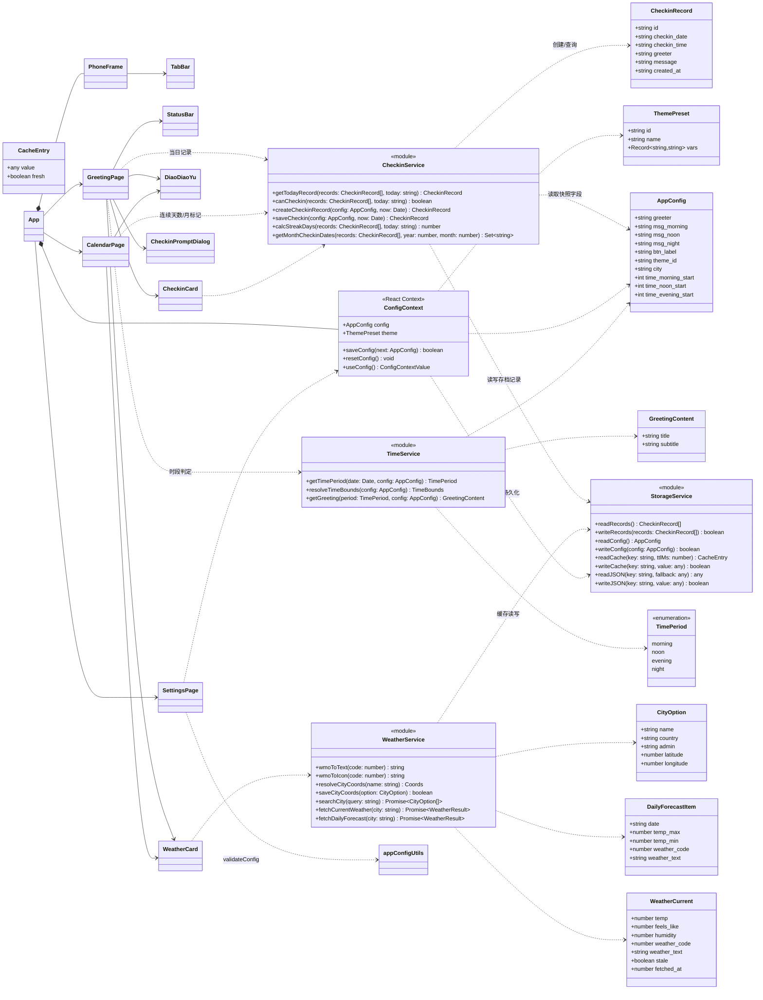
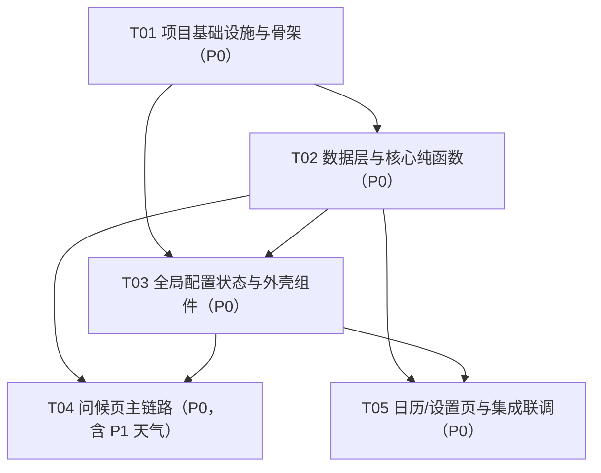

# 《存档吧！》系统架构设计与任务分解

> 版本 V1.0 · 2026-10-24 · 撰写：架构师 高见远（Bob） · 依据：PRD V1.0（许清楚）
>
> 技术栈（已裁定，不建议推翻）：Vite + React 18 + Tailwind CSS + JavaScript/JSX（不用 TypeScript）；单页 Tab 状态切换，不引路由库；不引 MUI；动效用 Tailwind config 自定义 keyframes。

---

## Part A：系统设计

### 1. 实现方案与选型理由

#### 1.1 架构总览

采用「**单页应用 + 全局配置 Context + Service 纯函数层**」三层架构：

```
┌──────────────────────────────────────────────┐
│ 页面层 pages/（GreetingPage / CalendarPage / SettingsPage） │
│   组合组件、消费 Context、调用 Service               │
├──────────────────────────────────────────────┤
│ 组件层 components/（PhoneFrame / TabBar / WeatherCard …） │
│   受控展示组件，props 驱动，不直接读写 localStorage     │
├──────────────────────────────────────────────┤
│ 状态层 context/ConfigContext.jsx                │
│   全局 AppConfig + 主题 CSS 变量注入                 │
├──────────────────────────────────────────────┤
│ 服务层 services/（time / checkin / weather）      │
│   纯函数 + storage 封装，可单测，不依赖 React/DOM     │
├──────────────────────────────────────────────┤
│ 工具层 utils/（appConfig / date / storage）       │
│   默认值、主题表、校验、本地日期格式化、localStorage 封装 │
└──────────────────────────────────────────────┘
```

**选型理由：**

| 决策点  | 选择                            | 理由                                                                                                           |
| ---- | ----------------------------- | ------------------------------------------------------------------------------------------------------------ |
| 框架   | React 18（函数组件 + Hooks）        | 团队已裁定；SPA + Tab 状态切换无需路由库，`useState` 管理 `activeTab` 即可，减少依赖与构建摩擦                                             |
| 样式   | Tailwind CSS 3.4 + CSS 变量主题   | PRD 要求 4 套预设 CSS 变量切换；Tailwind `theme.extend.colors` 引用 `var(--bg)` 等变量，一个 class 体系同时服务 4 套主题，无需条件 className |
| 动效   | Tailwind config 自定义 keyframes | 呆呆鱼跳跃/摇摆/呼吸/庆祝/星星闪烁全部由 `animation` 扩展实现，零运行时动画库                                                              |
| 持久化  | localStorage 双 key + 天气缓存 key | PRD R10 裁定；`utils/storage.js` 统一封装，读写都过 try/catch 兜底                                                         |
| 天气   | Open-Meteo（免 key）+ Geocoding  | PRD 裁定；`services/weatherService.js` 实现「缓存优先 → 网络 → 旧缓存 stale → mock」四级降级，永不向 UI 抛异常                          |
| 状态管理 | React Context（仅配置域）           | 全局只有 AppConfig 一个共享状态域，Context 足够，不引 Redux/Zustand                                                           |
| 测试   | Vitest（environment: node）     | 核心逻辑全部为纯函数，node 环境即可覆盖；配置并入 `vite.config.js` 的 `test` 字段                                                     |

#### 1.2 核心难点与对策

**难点 1：四时段判定与跨时段自动刷新（R01/IR6）**

- 时段判定抽成纯函数 `TimeService.getTimePeriod(date, config)`，按「小时」整数做**左闭右开**判断：`[morningStart, noonStart)` 早、`[noonStart, eveningStart)` 午、`[eveningStart, 24)` 晚、其余深夜。边界可由 config 的 `time_morning_start/time_noon_start/time_evening_start` 配置（R18，v1.2），缺省回退默认 `05/12/18`（与 v1.1 行为一致）；保存侧 `validateTimeBounds` 保证严格递增，四段合起来恰好覆盖 24 小时无重叠。边界分钟（11:59/12:00、17:59/18:00、23:59/00:00）天然正确，无浮点比较风险。
- 跨时段刷新由问候页内部的 `useNow(30000)` Hook 实现：30s `setInterval` 兜底 + `visibilitychange` 回到前台立即重算。时段变化 → `getTimePeriod` 返回新值 → React 重渲染问候页，无需手动刷新页面。

**难点 2：存档当日唯一性与状态机（R02/IR1/IR4）**

- 唯一性在**存储层查重**：`CheckinService.saveCheckin()` 先 `readRecords()`，按 `checkin_date === 今日` 查重，已存在则直接返回 `null`（不写第二条），从机制上保证「重复进入/重复点击不产生第二条记录」。
- UI 状态机：`未存档（主橙可点）→ 点击写入 → 已存档（置灰「已存档」+「今日已存档，明天见」）`；跨日后 `formatDate(new Date())` 变化，`getTodayRecord` 返回 null，按钮自动复位可点（IR4）。
- 写入时**快照**当日 `greeter` 与 `msg_night`，历史日详情不随后续改配置失真（R08/G3）。

**难点 3：主题 CSS 变量架构（R04）**

- `utils/appConfig.js` 定义 4 套主题，每套是一组 CSS 变量映射（`--bg/--primary/--accent/--text/--text-sub`）。
- `ConfigContext` 的 `useEffect` 监听 `theme` 变化，把变量写到 `document.documentElement.style`，**全 App 即时生效**；`theme_id` 随配置持久化，刷新后保持。
- Tailwind 侧做 token 映射（见 8.2），业务代码只写语义 class（`bg-surface`/`bg-brand`/`text-ink`），主题切换对组件透明。
- `index.css` 的 `:root` 预置默认主题变量，保证 Provider 挂载前首屏不闪烁。

**难点 4：天气缓存降级链（R13-R16）**

- 降级链：**新鲜缓存（current TTL 30min / daily TTL 3h）→ Open-Meteo 请求 → 旧缓存（stale 标记）→ mock 兜底**。任何一步失败都不会白屏或报错，兜底态在卡片右下角标注「数据可能不是最新」。
- 缓存结构统一为 `{ cached_at, value }` 包一层，`StorageService.readCache(key, ttlMs)` 返回 `{value, fresh}`，由调用方决定新鲜/过期用法。
- WMO code → 中文/图标映射为纯函数常量表（`wmoToText`/`wmoToIcon`），可单测。
- 城市坐标解析：默认城市「北京」内置坐标；用户搜索选中的城市坐标缓存到 `archive.city_coords`，重启后保持（R15）。

**难点 5：本地时区日期规范（R10）**

- 全站禁用 `toISOString()`（会漂移到 UTC）。`utils/date.js` 统一用 `getFullYear/getMonth/getDate/getHours…` + `pad2` 手工拼接 `YYYY-MM-DD` / `HH:mm:ss` / `YYYY-MM-DD HH:mm:ss`，所有组件/service 只使用这一组函数。

#### 1.3 可测试性设计（为 QA 预留）

- `src/utils/` 与 `src/services/` **禁止 import React/DOM**，全部为 ES module 纯函数（services 仅额外依赖 utils/storage）。
- 时段判定、存档状态机、连续天数、配置校验、日期格式化、月矩阵、WMO 映射均为无副作用纯函数，QA 用 Vitest 直接 import 断言（测试目录约定见 8.6）。

---

### 2. 文件清单（26 个，相对路径）

```
archive-app/
├── index.html                     # 入口 HTML（lang=zh-CN，viewport-fit=cover）
├── package.json                   # 依赖声明与脚本（dev/build/test）
├── vite.config.js                 # Vite 配置 + vitest test 字段
├── tailwind.config.js             # 主题 token（CSS 变量映射）+ 自定义 keyframes/animation
├── postcss.config.js              # PostCSS 管线（tailwindcss + autoprefixer）
├── .gitignore                     # 忽略 node_modules / dist
├── public/
│   └── assets/daidaiyu.jpg        # 【已就位】呆呆鱼 IP 单图，不重复创建
└── src/
    ├── main.jsx                   # React 入口（createRoot + StrictMode）
    ├── App.jsx                    # 应用外壳：ConfigProvider 挂载 + activeTab 状态 + 三页切换
    ├── index.css                  # Tailwind 三条指令 + 全局样式 + :root 默认主题变量
    ├── utils/
    │   ├── appConfig.js           # DEFAULT_CONFIG / THEMES / FIELD_RULES / TIME_FIELD_RULES / validateConfig / validateTimeBounds / getThemeById（纯函数）
    │   ├── date.js                # formatDate/formatTime/formatDateTime/shiftDate/getMonthMatrix（纯函数，本地时区）
    │   └── storage.js             # localStorage 封装：双 key + 天气缓存 readCache/writeCache
    ├── services/
    │   ├── timeService.js         # getTimePeriod / resolveTimeBounds / getGreeting（纯函数，时段边界可配置）
    │   ├── checkinService.js      # 存档状态机：getTodayRecord/canCheckin/saveCheckin/calcStreakDays/getMonthCheckinDates
    │   └── weatherService.js      # Open-Meteo 请求 + 缓存降级链 + WMO 映射 + 城市搜索
    ├── context/
    │   └── ConfigContext.jsx      # 全局配置 Context：config/theme/saveConfig/resetConfig + 主题变量注入
    ├── components/
    │   ├── PhoneFrame.jsx         # 手机壳容器（桌面 390×844 居中，移动端全屏）
    │   ├── StatusBar.jsx          # 顶部淡蓝状态栏（时间 + 日期周几）
    │   ├── TabBar.jsx             # 底部三 Tab 导航（问候/日历/设置）
    │   ├── WeatherCard.jsx        # 天气卡双形态：variant="current"（问候页）/ "forecast"（日历页）
    │   ├── DiaoDiaoYu.jsx         # IP 形象：时段表情徽章 + 动效 + 庆祝粒子
    │   ├── CheckinCard.jsx        # 晚间打卡卡：存档按钮 + 置灰态 + 庆祝反馈序列
    │   └── CheckinPromptDialog.jsx # 晚间未存档提醒对话框（v1.2 R17）：呆呆鱼 + 文案 + 主按钮 + 稍后再说
    └── pages/
        ├── GreetingPage.jsx       # 问候页：四时段渲染 + useNow 时段刷新 + 快捷入口 + 晚间未存档提醒
        ├── CalendarPage.jsx       # 日历页：月份切换/连续徽章/月视图/日详情/预报区块
        └── SettingsPage.jsx       # 设置页：5 项文案输入/时间分段/实时预览/主题/城市搜索/恢复默认/保存校验
```

> 说明：`docs/`（PRD、本设计、两个 .mermaid）与 `public/assets/daidaiyu.jpg` 不计入上述 26 个工程文件清单。

---

### 3. 数据结构与接口（classDiagram）



**关键接口签名速查（供工程师直接对齐）：**

```js
// utils/date.js（全部本地时区拼接，禁 toISOString）
formatDate(date) → 'YYYY-MM-DD'
formatTime(date) → 'HH:mm:ss'
formatDateTime(date) → 'YYYY-MM-DD HH:mm:ss'
shiftDate(dateStr, days) → 'YYYY-MM-DD'          // 日历日加减，供连续天数计算
getMonthMatrix(year, month) → Array<{dateStr, day, inMonth}>  // 固定 42 格（6×7），周日起始
getWeekdayLabel(date) → '周日'|'周一'|…|'周六'

// services/timeService.js
getTimePeriod(date, config) → 'morning' | 'noon' | 'evening' | 'night'  // config 缺省回退默认边界 5/12/18（R18）
resolveTimeBounds(config) → { morningStart, noonStart, eveningStart }  // 非法/缺失值逐个回退默认（R18）
getGreeting(period, config) → { title, subtitle }
//   morning → { title: '早上好', subtitle: `用户${greeter}提醒您，${msg_morning}` }
//   noon    → { title: '中午好', subtitle: `用户${greeter}提醒您，${msg_noon}` }
//   evening → { title: '',       subtitle: `用户${greeter}提醒您，${msg_night}` }（不加前缀）
//   night   → { title: '夜深了', subtitle: `用户${greeter}提醒您，${msg_night}` }（与早/午/晚结构一致，24 小时均有问好）

// services/checkinService.js
saveCheckin(config, now) → CheckinRecord | null   // null = 当日已存在（DB 层当日唯一）
calcStreakDays(records, todayStr) → number        // 今日未存则从昨日向前连续计数

// services/weatherService.js
fetchCurrentWeather(city) → { data: WeatherCurrent, stale: boolean }
fetchDailyForecast(city) → { data: DailyForecastItem[], stale: boolean }
searchCity(query) → CityOption[]                  // 失败返回 []
```


### 5. 待明确事项与假设

1. **定位策略**：不做浏览器地理定位授权流程。默认城市「北京」（内置坐标 `39.9042, 116.4074`）；用户经设置页 Geocoding 搜索选城市后，城市坐标缓存到 `archive.city_coords`（`{name, latitude, longitude}`），重启后保持（R15）。若配置的 city 无缓存坐标（极端情况），按默认北京坐标兜底。
2. **午间天气卡「简讯态」**：PRD 4.1 描述中午天气卡「可收起为一行简讯」。为实现简单、不过度设计，问候页午间固定渲染紧凑单行布局（`WeatherCard variant="compact"`），不做展开/收起交互。
3. **早/午快捷入口**：PRD 问候页组件清单提及「快捷入口 ×2」。实现为早/午时段问候区下方两个小按钮（日历/设置），点击切换 Tab；晚间被打卡卡替代，深夜不展示。
4. **连续天数语义**：今日尚未存档时，从**昨日**起向前连续计数（今天不打断连续）；昨日也断档则为 0。对应 R09「断档次日清零」。
5. **未来预报窗口**：预报从「明天」起算，请求 8 天窗口取明天起 7 天，默认展示前 5 天，可展开至 7 天（R14）。
6. **created_at 格式**：使用本地 `YYYY-MM-DD HH:mm:ss` 字符串（与全站本地时间规范一致，不用 ISO/UTC）。
7. **恢复默认范围**：R06 定义「还原 5 项文案 + 默认主题」，即 `greeter/msg_morning/msg_noon/msg_night/btn_label/theme_id` 共 6 项；**city 不重置**（保持用户所选城市）。v1.2 起时段边界（`time_morning_start/time_noon_start/time_evening_start`）一并恢复默认 5/12/18（R18）。
8. **id 生成**：优先 `crypto.randomUUID()`，不可用时降级 `` `${Date.now()}-${Math.random().toString(36).slice(2)}` ``。
9. **庆祝动效参数**：呆呆鱼庆祝 = 上浮 + 旋转 + 8 颗星星粒子，总时长 800ms（R12 上限内）；`navigator.vibrate(40)` 做存在性守卫，桌面端无感降级。
10. **测试环境**：QA 单元测试目录约定 `tests/`，Vitest `environment: 'node'`（覆盖全部纯函数）；如需组件级测试，后续可自行加装 jsdom，不影响本设计的源码分层。
11. **周起始日**：日历月视图星期头自「周日」起（日 一 二 三 四 五 六），与 `getMonthMatrix` 的 42 格矩阵一致。

---

## Part B：任务分解

### 6. 依赖包清单

```
- react@^18.3.1: UI 框架（函数组件 + Hooks）
- react-dom@^18.3.1: React DOM 渲染入口
- vite@^5.4.8: 构建与开发服务器
- @vitejs/plugin-react@^4.3.4: Vite 官方 React 插件（JSX + 快速刷新）
- tailwindcss@^3.4.13: 原子化 CSS 框架（v3，配合 tailwind.config.js）
- postcss@^8.4.47: CSS 处理管线
- autoprefixer@^10.4.20: 自动补全厂商前缀
- vitest@^2.1.3: 单元测试框架（devDependencies，配置并入 vite.config.js）
```

Node 版本要求：`>=18`。不引入 TypeScript、路由库、组件库、状态管理库、动画库。

### 7. 任务列表（按依赖排序，硬性上限 5 个）

#### T01 项目基础设施与骨架（P0）

- **源文件**：`package.json`、`vite.config.js`、`tailwind.config.js`、`postcss.config.js`、`index.html`、`.gitignore`、`src/main.jsx`、`src/App.jsx`、`src/index.css`
- **依赖**：无
- **内容与验收**：
  - `package.json` 声明第 6 节全部依赖与脚本（`dev/build/preview/test`）；`npm install` 可执行。
  - `vite.config.js` 挂 `@vitejs/plugin-react` 与 `test` 字段（`environment: 'node'`、`globals: true`、`include: ['tests/**/*.test.js']`）。
  - `tailwind.config.js` 完成颜色 token 映射（见 8.2）、`borderRadius.card/btn`、`boxShadow.card`、6 组自定义 keyframes/animation（jump/sway/breathe/float-slow/celebrate/twinkle）。
  - `index.html`（lang=zh-CN、viewport-fit=cover、title「存档吧！」）；`src/main.jsx` 标准入口；`src/index.css` 含 Tailwind 指令 + `:root` 默认主题变量 + 全局字体/滚动设置。
  - `src/App.jsx` 骨架：`activeTab` state + 三页占位渲染 + TabBar 占位；`npm run dev` 启动无报错，默认米白底生效。

#### T02 数据层与核心纯函数（P0）

- **源文件**：`src/utils/appConfig.js`、`src/utils/date.js`、`src/utils/storage.js`、`src/services/timeService.js`、`src/services/checkinService.js`、`src/services/weatherService.js`
- **依赖**：T01
- **内容与验收**：
  - `appConfig.js`：`DEFAULT_CONFIG`（提示人 Deep seek / 三段默认文案 / 按钮「存档」/ 主题 warm-orange / 城市北京 / 时段边界 5/12/18）、`THEMES`（4 套 CSS 变量）、`FIELD_RULES`（20/50/50/50/6 字符上限）、`TIME_FIELD_RULES` 与 `validateTimeBounds`（0-23 整数严格递增，R18）、`validateConfig`（trim 非空 + 长度 + 时间校验合并）、`getThemeById`。
  - `date.js`：本地时区格式化四件套 + `shiftDate` + `getMonthMatrix`（42 格）+ 星期标签；**禁止出现 toISOString**。
  - `storage.js`：双 key 读写（`archive.checkin_records` / `archive.app_config`）+ `readCache(key, ttlMs)`/`writeCache`（`{cached_at, value}` 结构）+ 全方法 try/catch 兜底。
  - `timeService.js`：`getTimePeriod(date, config)`（左闭右开四时段，边界可由 config 配置、缺省回退 5/12/18，R18）+ `resolveTimeBounds`/`DEFAULT_TIME_BOUNDS` + `getGreeting`（四时段文案，晚间不加前缀）。
  - `checkinService.js`：`saveCheckin`（查重当日唯一 + 快照）、`getTodayRecord`、`canCheckin`、`calcStreakDays`、`getMonthCheckinDates`。
  - `weatherService.js`：`wmoToText/wmoToIcon`、`searchCity`（Geocoding，language=zh）、`fetchCurrentWeather`（TTL 30min）、`fetchDailyForecast`（TTL 3h，明天起 7 天窗口）、`resolveCityCoords/saveCityCoords`、mock 兜底；**任何网络失败不得 throw**。
  - 验收：`npm test` 可跑通 QA 提供的纯函数用例；本任务文件零 React 依赖。

#### T03 全局配置状态与应用外壳组件（P0）

- **源文件**：`src/context/ConfigContext.jsx`、`src/components/PhoneFrame.jsx`、`src/components/StatusBar.jsx`、`src/components/TabBar.jsx`
- **依赖**：T01、T02
- **内容与验收**：
  - `ConfigContext.jsx`：`ConfigProvider` 挂载时 `readConfig()` 合并默认值；`useEffect` 按 `theme.vars` 写入 `document.documentElement` CSS 变量；暴露 `config/theme/saveConfig/resetConfig` 与 `useConfig()` hook；`saveConfig` 写入成功后同步 state（IR7 基础）。
  - `PhoneFrame.jsx`：桌面 `md:` 断点下 390×844 圆角手机壳居中（外层深色底衬托），移动端全屏；flex 列布局，内容区由使用方以 `flex-1 overflow-y-auto` 包裹。
  - `StatusBar.jsx`：props `{ now: Date }`，淡蓝（`bg-tint/20`）顶条，左 `HH:mm`、右「M月D日 周X」。
  - `TabBar.jsx`：props `{ active, onChange }`，三 Tab（问候/日历/设置）图标 + 文案，激活态 `text-brand` 加粗，未激活 `text-ink-sub`。
  - 验收：Provider 包住外壳后，切换 `theme_id` 全屏 CSS 变量即时变化；Tab 点击回调正确。

#### T04 问候页主链路（P0，内嵌 P1 天气）

- **源文件**：`src/pages/GreetingPage.jsx`、`src/components/WeatherCard.jsx`、`src/components/DiaoDiaoYu.jsx`、`src/components/CheckinCard.jsx`、`src/components/CheckinPromptDialog.jsx`
- **依赖**：T01、T02、T03
- **内容与验收**：
  - `GreetingPage.jsx`：内部实现并导出 `useNow(30000)`（interval + `visibilitychange`）；按时段分支渲染——早/午（大标题+副标题+快捷入口）、晚（完整句+打卡卡）、深夜（大号时间+问候标题「夜深了」+可配置副标题，无天气卡；v1.3 起含极简存档入口：未存档→描边按钮、已存档→弱提示「今日已存档 ✓」，复用 `handleCheckin` + 庆祝态）；`todayRecord` 由 `readRecords()` + `getTodayRecord` 计算，随 `now` 跨日自动复位。v1.2 起时段判定传 `config`（R18）；晚间且当日未存档时渲染 `CheckinPromptDialog`（R17：主按钮走 `handleCheckin`，「稍后再说」/遮罩 = `promptDismissed` 本次会话关闭，`todayStr` 跨日变化时复位）。
  - `CheckinPromptDialog.jsx`（v1.2 新增）：props `{ btnLabel, message, onArchive, onDismiss }`；fixed 遮罩 + 居中白卡（呆呆鱼晚间形象 + 「今晚还没存档哦」+ 可配置文案 + 主按钮 + 「稍后再说」）；点遮罩关闭、点卡片 `stopPropagation` 不误关；存档成功后父级 `todayRecord` 更新，弹出条件自动失效。
  - `DiaoDiaoYu.jsx`：props `{ period, celebrating, size }`；单图 `/assets/daidaiyu.jpg` + 时段徽章（☀️ 元气/😴 慵懒/🌙 欣慰/💤）+ 动效（jump/sway+breathe/float-slow/celebrate+8 星星粒子）；v1.3 起全天彩色（去掉深夜 grayscale，用户反馈恢复 IP 原彩）；动效 ≤800ms 不阻塞交互。
  - `WeatherCard.jsx`：props `{ variant: 'current'|'compact'|'forecast' }`；mount 时经 `weatherService` 拉取（city 变自动重取）；`stale` 时右下角「数据可能不是最新」；forecast 形态横滚列表 + 「展开 7 天」。
  - `CheckinCard.jsx`：props `{ btnLabel, todayRecord, onCheckin }`；状态机三态（可点/已存置灰/庆祝中）；点击 → `onCheckin()` 返回 record → 庆祝动效 + `navigator.vibrate(40)`；重复点击 disabled 拦截。
  - 验收：四时段内容正确切换；晚间首点即落库置灰，重复进入不产生第二条；早/午无打卡卡、深夜为极简描边存档入口（v1.3，未存档→按钮/已存档→弱提示）；天气断网走兜底不白屏；晚间未存档进入即弹提醒框、主按钮点击后存档并关闭；自定义时间边界后四时段切换正确。

#### T05 日历/设置页与三页集成联调（P0）

- **源文件**：`src/pages/CalendarPage.jsx`、`src/pages/SettingsPage.jsx`、`src/App.jsx`（修改：接入 `ConfigProvider`、三页 Tab 切换挂载）
- **依赖**：T01、T02、T03
- **内容与验收**：
  - `CalendarPage.jsx`：月份切换头（`‹ YYYY年M月 ›` + 「回到当月」）、连续徽章（`calcStreakDays`）、月视图 7×6 网格（已存日 `#FF8C42` 6-8px 圆点、今日 `--accent` 1.5px 描边、空白日 #CCC）、日详情卡（`HH:mm:ss` + 文案快照 / 「这一天没有留下记录」）、天气区块（城市名 + `WeatherCard variant="forecast"`）、月份头旁 64px 静态呆呆鱼。
  - `SettingsPage.jsx`：draft 状态（自 `useConfig()` 初始化）；5 个输入行（label + maxLength + n/上限计数）；时间分区间（v1.2 R18：早/中/晚开始时间三个输入行，`updateTimeField` 做整数解析、非法时保留原串供保存报错，`getTimePeriod(now, draft)` 使预览时段随草稿实时变化）；实时预览卡（当前时段问候 + 自定义按钮 + 三段并列高亮）；4 主题单选卡；城市搜索（输入 → `searchCity` → 结果列表 → 选中写 `archive.city_coords` 并更新 draft.city）；恢复默认（行内二次确认「确认恢复？」，还原 6 项文案 + 默认主题 + 默认时段边界，不含 city）；保存（`validateConfig` → 红描边行内报错 / 通过则 `saveConfig` + 「已保存」行内提示）。
  - `App.jsx`：`ConfigProvider` 包裹 `PhoneFrame`；`activeTab` 驱动三页切换；问候页 `onNavigate` 支持快捷入口跳 Tab。
  - 验收：P0/P1 需求（R01-R16）全流程可跑通；Tab 切换无白屏；设置保存后返回问候页即时生效；刷新后数据/主题/城市不丢失。


### 8. 共享知识（跨文件约定，工程师必读）

#### 8.1 localStorage 键位与读写封装

| 键                         | 结构                                               | 读写入口                               |
| ------------------------- | ------------------------------------------------ | ---------------------------------- |
| `archive.checkin_records` | `CheckinRecord[]`（JSON 数组，`checkin_date` 唯一）     | `readRecords()/writeRecords()`     |
| `archive.app_config`      | `AppConfig`（JSON 对象）                             | `readConfig()/writeConfig()`       |
| `archive.weather_current` | `{cached_at, value: WeatherCurrent}`，TTL 30min   | `readCache/writeCache`             |
| `archive.weather_daily`   | `{cached_at, value: DailyForecastItem[]}`，TTL 3h | `readCache/writeCache`             |
| `archive.city_coords`     | `{name, latitude, longitude}`                    | `saveCityCoords/resolveCityCoords` |

- **只有 `utils/storage.js` 与 `services/*` 允许直接接触 `localStorage`**；组件一律经 Context/Service 获取数据。
- 所有读写 try/catch：解析失败返回 fallback，写入失败返回 false，绝不向 UI 抛异常。

#### 8.2 日期时间格式规范

- 全站使用 `utils/date.js` 的 `formatDate/formatTime/formatDateTime/shiftDate`；**禁止 `toISOString()`**（UTC 漂移）。
- 日期串 `YYYY-MM-DD`，时间串 `HH:mm:ss`，`checkin_date` 当日唯一；月矩阵比较用字符串前缀。

#### 8.3 主题注入与 Tailwind token 映射

- CSS 变量（PRD 规定名）：`--bg / --primary / --accent / --text / --text-sub`，由 `ConfigContext` 写入 `document.documentElement`；`index.css :root` 预置默认值防首屏闪烁。
- Tailwind 语义 token 与业务 class 对照（**组件只写右侧 class**）：

| CSS 变量       | Tailwind 颜色 token | 业务 class 示例                                |
| ------------ | ----------------- | ------------------------------------------ |
| `--bg`       | `surface`         | `bg-surface`                               |
| `--primary`  | `brand`           | `bg-brand` / `text-brand` / `border-brand` |
| `--accent`   | `tint`            | `bg-tint` / `border-tint`                  |
| `--text`     | `ink`             | `text-ink`                                 |
| `--text-sub` | `ink-sub`         | `text-ink-sub`                             |

- 橙点/存档按钮一律 `bg-brand`（主题切换后自动跟随）；报错红 `#E5484D` 为固定 `danger` token，不随主题变。

#### 8.4 组件与 Props 约定

- 页面组件 default export；工具/服务模块命名导出；`ConfigContext` 导出 `ConfigProvider` + `useConfig`。
- 组件不直接 `import` service 的写操作（存档写经 `CheckinCard.onCheckin` 回调由页面编排）；展示型组件（StatusBar/TabBar/DiaoDiaoYu/PhoneFrame）纯 props 驱动，可单独预览。
- IP 图片路径固定 `/assets/daidaiyu.jpg`（public 目录，绝对路径引用）。
- 反馈规范（IR3/IR8）：行内文案/Toast，禁 `alert/confirm`；震动 `if (navigator.vibrate) navigator.vibrate(40)`。

#### 8.5 纯函数模块边界（QA 测试契约）

- `src/utils/**` 与 `src/services/**` **禁止 import react / react-dom / 任何 DOM API**；services 只允许依赖 utils。
- 纯函数命名与签名以第 3 节「关键接口签名速查」为准；测试放 `tests/*.test.js`，`npm test`（vitest run）执行。
- 天气 service 对外永不 reject：统一返回 `{ data, stale }`，由 UI 决定兜底文案。

#### 8.6 其他

- 文案快照：存档写入时冻结 `greeter` + `msg_night`；日详情只读快照，不引用当前 config。
- 设置页草稿与生效配置分离：draft 驱动实时预览，`saveConfig` 才落库生效。
- 所有用户可见文案为中文；默认值以 `DEFAULT_CONFIG` 为唯一来源，禁止在组件里硬编码默认文案。

### 9. 任务依赖图



> T04 与 T05 在 T03 完成后可并行；两者均只依赖 T01/T02/T03，无相互依赖，避免线性长链。

---

## 附：交付物索引

| 文件                              | 内容                                     |
| ------------------------------- | -------------------------------------- |
| `docs/system_design.md`         | 本文档（Part A 系统设计 + Part B 任务分解）         |
| `docs/sequence-diagram.mermaid` | 4 个关键流程时序图（启动问候 / 晚间存档 / 自定义保存 / 天气降级） |
| `docs/class-diagram.mermaid`    | 数据模型 + Service + Context + 组件类图        |
